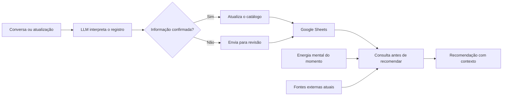

# Catálogo de Entretenimento com LLM

Eu mantinha filmes, séries, animes, documentários e jogos em listas separadas. O problema não era apenas lembrar o que queria assistir: uma recomendação podia repetir algo já concluído, ignorar uma avaliação ruim ou confundir um título apenas citado com algo que realmente entrou na lista.

Criei este MVP para transformar esse histórico em contexto útil para uma LLM. O catálogo fica no Google Sheets, as fontes e os registros auxiliares ficam organizados no Google Drive e as regras orientam a recomendação antes que o modelo sugira um título.

O projeto já foi aplicado com uma base funcional. Este repositório publica a arquitetura, as regras e exemplos fictícios. Meu histórico real, minhas avaliações e os links privados da base não fazem parte da versão pública.

## O que o MVP resolve

- reúne filmes, séries, animes, documentários e jogos em um catálogo;
- diferencia o que foi concluído, pausado, abandonado ou ainda está pendente;
- mantém progresso, nota, prioridade e próxima ação;
- atribui a cada conteúdo um nível de energia mental necessária;
- registra títulos alternativos para reduzir duplicidades;
- separa informação confirmada de algo que ainda precisa de validação;
- consulta o histórico antes de fazer uma recomendação;
- usa a avaliação pessoal como sinal principal de preferência;
- consulta fontes atuais antes de afirmar disponibilidade, data ou plataforma.

Além do histórico, a recomendação considera **como estou naquele momento**. Posso informar que minha energia mental está baixa, média ou alta. O assistente procura conteúdos compatíveis: algo mais fácil de acompanhar quando estou cansado, uma obra que exige atenção moderada quando estou disposto ou um conteúdo mais denso quando tenho energia para me envolver.

## Como funciona

Antes de recomendar, o assistente verifica o catálogo. Um título concluído não volta como novidade. Algo abandonado ou mal avaliado pesa contra sugestões parecidas. Um item marcado como `precisa_confirmar` não é tratado como assistido.

O nível de energia não mede se uma obra é boa ou ruim. Ele representa o esforço que ela costuma exigir de mim. A mesma categoria pode ter conteúdos leves, moderados ou intensos.

## Estrutura da base

| Aba | Uso |
| --- | --- |
| `Catálogo` | Base principal com todos os registros |
| `Resumo` | Indicadores por estado e categoria |
| `Regras` | Critérios de atualização e recomendação |
| `Fontes` | Ordem das fontes externas |
| `Como usar` | Procedimento para consultar e atualizar |
| `Listas` | Valores aceitos para estado, tipo e prioridade |
| `Quero ver` | Visão dos itens pendentes |
| `Assistidos` | Visão do que foi concluído |
| `Em andamento` | Visão do consumo atual |
| `Revisão` | Registros que precisam de confirmação |

O modelo de dados está em [docs/modelo-de-dados.md](docs/modelo-de-dados.md). O arquivo em [examples/catalogo.csv](examples/catalogo.csv) usa títulos inventados para mostrar o formato sem publicar meu histórico.

## Regras que fizeram diferença

- **O histórico vem antes da recomendação.** A LLM consulta a base antes de sugerir.
- **Minha nota tem mais peso.** Avaliações externas ajudam a explicar o risco, mas não substituem o gosto registrado.
- **A energia do momento filtra a lista.** O assistente cruza minha disposição atual com a energia atribuída a cada conteúdo.
- **Citado não significa assistido.** Estados incertos permanecem separados até uma confirmação.
- **Disponibilidade exige fonte atual.** Catálogos de streaming e datas mudam.
- **Títulos alternativos são preservados.** Isso reduz duplicidade entre nomes em português, nomes originais e abreviações.
- **A recomendação precisa explicar a relação.** O resultado mostra quais sinais do histórico sustentam a sugestão.

## Engenharia de prompt

As instruções foram organizadas como um contrato de consulta e atualização. Primeiro identificar a intenção, depois localizar o título, verificar duplicidade, interpretar o estado e somente então escrever na base ou recomendar.

Também separei confiança de estado. Um registro pode ter estado `quero_ver`, mas confiança baixa quando o título exato não foi identificado. Essa separação evita transformar uma conversa vaga em dado confirmado.

O desenho está detalhado em [docs/engenharia-de-prompt.md](docs/engenharia-de-prompt.md).

## Situação atual

A planilha oficial possui uma base principal, visões por estado, resumo, regras, fontes e uma fila de revisão. O fluxo já consegue manter um histórico consultável e usar esse histórico para reduzir recomendações repetidas ou incompatíveis.

Os próximos testes devem medir duplicidades, qualidade da normalização dos títulos, atualização de progresso e quanto as recomendações melhoram quando notas e rejeições passam a ser usadas de forma consistente.

## Documentação

- [Arquitetura](docs/arquitetura.md)
- [Modelo de dados](docs/modelo-de-dados.md)
- [Regras de recomendação](docs/regras-de-recomendacao.md)
- [Engenharia de prompt](docs/engenharia-de-prompt.md)
- [Decisões](docs/decisoes.md)
- [Limitações e próximos testes](docs/limitacoes.md)
- [Segurança e privacidade](SECURITY.md)

## Licença

A documentação e os exemplos podem ser usados como referência. A base pessoal, as avaliações reais e os arquivos privados não fazem parte do projeto público.
