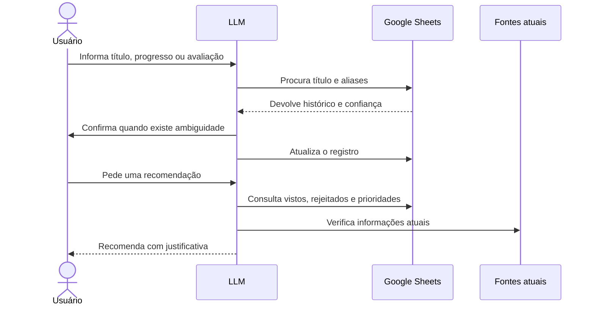

# Arquitetura

O MVP separa o raciocínio da LLM, a persistência dos registros e as fontes usadas para informações que mudam com o tempo.

## Componentes

### LLM

Interpreta a conversa, identifica o título, normaliza estado e progresso, consulta o histórico e prepara uma atualização compatível com a planilha. Também usa as regras do catálogo antes de recomendar.

### Google Sheets

Mantém a base principal e as visões por estado. A planilha permite revisar uma interpretação, corrigir um título e acompanhar os registros sem criar uma aplicação própria antes da validação do fluxo.

### Google Drive

Organiza exportações, fontes, recomendações, avaliações externas, histórico, snapshots e arquivos arquivados. Os endereços privados não são publicados.

### Fontes externas

Servem para críticas e informações atuais. Disponibilidade em streaming, datas e catálogo sempre precisam de nova consulta porque mudam com frequência.

## Fluxo

## Princípio central

A LLM não é a base de dados. Ela interpreta e consulta. O Sheets mantém o estado e o Drive organiza o material auxiliar. Assim, uma nova conversa não precisa reconstruir todo o histórico do zero.
